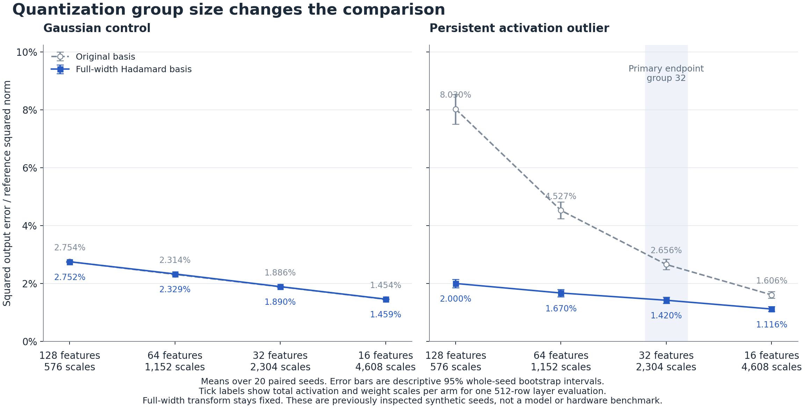

# What changes when the answer stays the same

A reproducible exposition on Hadamard matrices, changes of basis and quantization error.

Open [exposition.html](exposition.html) in a browser after downloading or cloning the repository. It contains the illustrated article, native MathML equations and an interactive four-coordinate calculator. All of its display assets are embedded. The editable manuscript is [article.md](article.md).

## Research question

An orthogonal change of basis preserves the exact linear product. Rounding depends on the representation and the quantizer's scale groups. This project proves the elementary identities and measures their consequences in small synthetic experiments.

The original experiment uses a known power-of-two Hadamard construction, 512 activation rows, 128 input features, 64 output features and 20 paired seeds. It quantizes both operands with symmetric four-bit maxabs codes from -7 through +7. Each activation row and weight output column shares one scale across all 128 input features.

All reported output errors are arithmetic means of seed-level relative squared Frobenius errors.

| Reference case | Original basis | Randomized Hadamard basis | Rotation wins |
|---|---:|---:|---:|
| Gaussian | 2.754490% | 2.751812% | 11 of 20 |
| Persistent outlier | 8.030172% | 1.999829% | 20 of 20 |
| Quantizer grid | 0% | 2.721075% | 0 of 20 |

[experiment.py](experiment.py) and [results.json](results.json) preserve that reference. The exact rational counterexample starts at `[7, 1, 1, 0]`. Its peak falls from 7 to 4.5 after transformation, while relative squared reconstruction error rises from zero to `11/3332`.

## Quantization group-size follow-up

[Issue #1](https://github.com/Whyme-Labs/hadamard-exposition/issues/1) records the follow-up protocol before execution. [The frozen protocol](docs/experiments/group-size-v1.md) fixes group sizes 128, 64, 32 and 16, with the full-width transform, original data and signs held constant.

The sweep includes both Gaussian and persistent-outlier cases. It preserves all 160 paired case, seed and group-size cells. The primary endpoint is the outlier case at group size 32. Smaller groups use more scales, so the comparison between bases is matched within each group size.

The existing 20 seeds had already been inspected in the reference study. This is a prespecified sensitivity study. The paired bootstrap intervals describe variation in these synthetic draws. The original grid-aligned counterexample stays in the reference experiment because its exact-representation guarantee does not extend automatically to smaller groups.

The complete follow-up results are in [group-results.json](group-results.json). The article includes the full sweep and its interpretation.

| Persistent-outlier group size | Scale slots per arm | Original error | Hadamard error | Reduction in mean error |
|---|---:|---:|---:|---:|
| 128 | 576 | 8.030172% | 1.999829% | 75.10% |
| 64 | 1,152 | 4.527049% | 1.670243% | 63.11% |
| **32, primary** | **2,304** | **2.656032%** | **1.419916%** | **46.54%** |
| 16 | 4,608 | 1.606158% | 1.116102% | 30.51% |

At the primary endpoint, the paired change is -1.236116 percentage points, with a descriptive 95% whole-seed bootstrap interval from -1.363456 to -1.112891 points. Rotation helps in all 20 outlier seeds at every group size. All four Gaussian intervals include zero, and three of their four mean changes slightly favor the original basis. The benefit is distribution-dependent and shrinks when the original basis gets more local scales.

Group size 128 reproduces all 520 corresponding numerical reference fields exactly in the recorded environment. The retained CPU sweep completed in 2.762 seconds under a 180-second outer deadline, with one observed BLAS thread. This is experiment runtime, not model inference performance.



## Matched model benchmark design

[Issue #2](https://github.com/Whyme-Labs/hadamard-exposition/issues/2) now has a [version 1 protocol](docs/experiments/model-benchmark-v1.md) and [machine-readable contract](benchmarks/model-benchmark-v1.json). They define six Pythia-70M CPU arms: original and rotated FP32 controls, matched packed four-bit weights at group 32, and group 16 sensitivity arms. Activations stay float32, so this application design is W4A32. Quality and timing must use the same ONNX graphs and runtime.

The intervention is limited to six post-GELU MLP output projections. Its online Hadamard transform uses Add/Sub butterflies, and the actual packed operator is ONNX Runtime `MatMulNBits` on the CPU provider. Generated-input controls check packing, rounding, padding, the full projection shape and valid versus invalid rotation placement. They establish numerical and format conformance, with no pretrained-model quality or inference-saving claim.

[benchmarks/README.md](benchmarks/README.md) documents the bounded local qualification. The protocol fixes model/data/software revisions, token selection, paired quality and timing decisions, resource ceilings and the full-model launch prerequisites. Acquisition, export and a development-only model parity/feasibility check belong to the later execution milestone.

The [accepted qualification and attempt history](validation/2026-10-17-model-benchmark/README.md) retain 38 passing tests, 20 passing runtime controls and valid process-identity-bound memory monitoring. The run completed in 6.194 seconds with about 179.3 MiB peak worker RSS, within its 180-second and 1 GiB limits. Two earlier resource-check defects and their original evidence are preserved. These numbers describe qualification cost, not model inference performance.

## Validate

The recorded numerical environment uses Python 3.12.14, NumPy 2.3.5 and Matplotlib 3.10.8. Install the pinned Python dependencies in a virtual environment:

```bash
python3 -m venv .venv
. .venv/bin/activate
python3 -m pip install -r requirements.txt
```

Node.js is needed for the calculator check. Run the complete validation, including a fresh numerical reproduction:

```bash
python3 scripts/validate.py --reproduce
```

The command checks numerical controls, retained receipts and the actual bundled calculator JavaScript. It reproduces the group sweep in a fresh temporary directory with one BLAS thread and a 180-second subprocess deadline. It compares numerical results within the tolerances in the frozen protocol and writes its receipt to `build/validation.json`. It leaves committed result files intact.

The [retained validation receipt](validation/2026-10-17-group-size.json) records the successful 17 October run: 25 focused tests, independent result checks, five calculator cases, a fresh group sweep and unchanged input bytes. Reproduction matched 3,085 deterministic numerical values within the protocol tolerances. The receipt identifies the source and result bytes it checked.

For retained-result and focused checks without another sweep:

```bash
python3 scripts/validate.py
```

## Reproduce or rebuild

Write a new reference run into a separate output directory:

```bash
OPENBLAS_NUM_THREADS=1 OMP_NUM_THREADS=1 MKL_NUM_THREADS=1 python3 experiment.py --output build/reference-run
```

Write a new group-size run:

```bash
OPENBLAS_NUM_THREADS=1 OMP_NUM_THREADS=1 MKL_NUM_THREADS=1 python3 group_experiment.py --output build/group-run
```

Add `--no-plots` when only numerical results are needed. Keep the committed reference and follow-up receipts as the original observations.

Pandoc is needed to rebuild the standalone article:

```bash
python3 scripts/build_article.py
node verify-calculator.cjs
```

The calculator check executes its actual JavaScript with a small DOM stub. It tests values and update events. Scientific figures are separately inspected.

## Tracking and scope

- [Issue #1](https://github.com/Whyme-Labs/hadamard-exposition/issues/1) tracks the reproducible exposition and group-size study.
- [Issue #2](https://github.com/Whyme-Labs/hadamard-exposition/issues/2) tracks the design of a matched model-quality and inference-cost benchmark.
- [CONTEXT.md](CONTEXT.md) defines the research vocabulary and boundaries.
- [docs/reference-import.json](docs/reference-import.json) records the original package and imported file hashes. It identifies the imported snapshot; later article and tooling edits have their own Git history.
- [sources.json](sources.json) records the primary references and the claims they support.

The reference and group-size results are synthetic error simulations in float64. The model-benchmark design adds actual packed-operator conformance checks on generated inputs. The project has not measured pretrained language-model quality or model inference improvements. It makes no claim of solving the general Hadamard conjecture or receiving a prize.

The related Lean execution qualification remains in [autoresearch-harness issue #175](https://github.com/Whyme-Labs/autoresearch-harness/issues/175) and [PR #176](https://github.com/Whyme-Labs/autoresearch-harness/pull/176).
