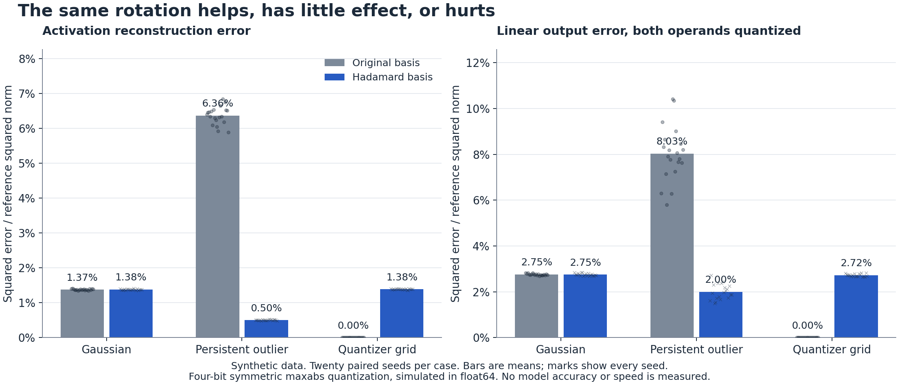
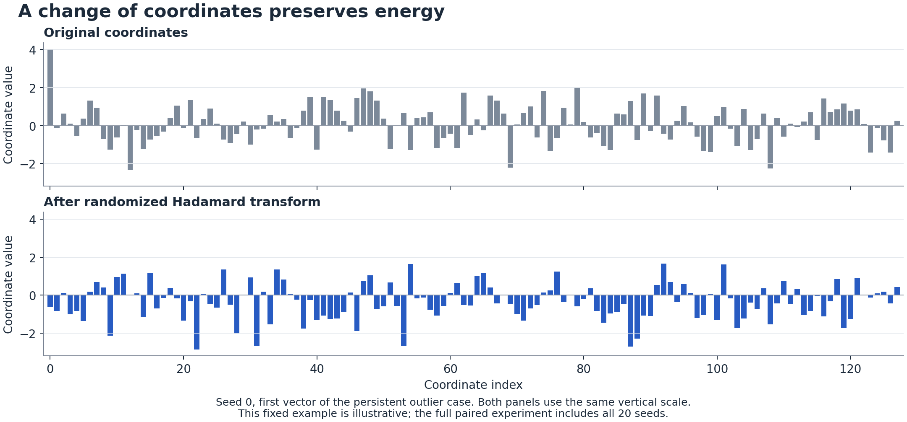

# What changes when the answer stays the same

## Hadamard matrices, quantization, and the price of a representation

17 October 2026. Exposition and reproducible experiment for review.

A calculation can keep exactly the same answer while becoming easier to approximate. That is a useful freedom. It means some of the cost of computation belongs to the coordinates we chose, rather than to the problem itself.

Hadamard matrices make this idea unusually concrete. Their entries are only plus one and minus one. After normalization, they can redistribute the coordinates of a vector without changing its length. Insert the corresponding inverse change into a linear layer and the exact output stays fixed. Round the transformed numbers to a small set of values, however, and the result can differ substantially from rounding the original numbers.

We tested this with a small CPU experiment. In a constructed case with one persistent activation outlier, a randomized Hadamard change of basis reduced mean relative squared output error from **8.030% to 2.000%**. On ordinary Gaussian data it made almost no difference. On data already aligned with the quantizer grid it increased error from **zero to 2.721%**.

A follow-up divided each 128-feature vector into smaller quantization groups. At the prespecified group size of 32, the outlier case improved from **2.656% to 1.420%**, a **46.5% reduction in mean error**. Giving the original basis more local scales reduced the transform's advantage. The comparison depends on the quantizer as well as the data.

These are measurements of synthetic linear layers. They establish neither language model accuracy nor hardware speed. Their value is that they expose the mechanism and its limits in an experiment small enough to inspect.

The mathematical question behind the exposition is much larger. The Hadamard conjecture asks whether every positive multiple of four admits a square matrix of plus and minus ones whose rows are mutually orthogonal. The Justin Sun Prize lists it as JSP-000013 and still marks it open. [1](https://github.com/TheJustinSunPrize/awards/blob/main/problems/catalog-0001-0100.md#jsp-000013--hadamard-matrix-conjecture)

### A matrix with an exact promise

An order $n$ Hadamard matrix is a real matrix $H$ with entries in $\{-1,+1\}$ such that

$$HH^{\mathsf T}=nI.$$

Every row has squared length $n$. Every pair of different rows has dot product zero. Dividing by $\sqrt n$ gives an orthogonal matrix

$$Q=\frac{H}{\sqrt n},\qquad QQ^{\mathsf T}=Q^{\mathsf T}Q=I.$$

The distinction matters. The raw plus and minus one matrix has rows of length $\sqrt n$. Its normalized version has rows of length one.

For a row vector $x$, multiplying by $Q$ preserves its squared Euclidean norm:

$$\|xQ\|_2^2=xQQ^{\mathsf T}x^{\mathsf T}=xx^{\mathsf T}=\|x\|_2^2.$$

It preserves dot products for the same reason. The entries can look completely different even though these relationships stay fixed. Quantization papers often call this a rotation. The precise object here is an orthogonal change of basis, which may also include a reflection.

The smallest nontrivial example is

$$H_2=\begin{bmatrix}1&1\\1&-1\end{bmatrix}.$$

There is a short construction that doubles an existing order:

$$H_{2n}=\begin{bmatrix}H_n&H_n\\H_n&-H_n\end{bmatrix}.$$

Multiplying this block matrix by its transpose gives zero in the off-diagonal blocks and $2nI$ in the diagonal blocks. Starting with $H_1=[1]$ therefore constructs a Hadamard matrix at every order that is a power of two.

That proves an infinite family. It does not prove the conjecture, because an infinite family can still miss infinitely many permitted orders.

### Why multiples of four appear

The restriction on the order follows from a counting argument.

Negate columns as needed to make the first row all plus ones. This preserves every row dot product. Orthogonality then forces any other row to contain equally many plus and minus ones, so $n$ is even.

Assume $n>2$ and reorder the columns so the second row has its plus ones in the first half and its minus ones in the second half. Let the third row contain $a$ plus ones in the first half and $b$ in the second half.

Orthogonality with the first row gives

$$a+b=\frac n2.$$

Orthogonality with the second row gives $a=b$. Consequently, $a=b=n/4$, which must be an integer.

Orders one and two are exceptions. Every larger order must be divisible by four. The open question asks whether that necessary condition is also sufficient. Checking many finite orders, proving a special construction, or showing that a restricted class cannot exist does not settle that universal claim.

### The representation can change while the layer stays fixed

Consider a linear layer with an activation matrix $X$, weight matrix $W$, and output

$$Y=XW.$$

Use any compatible orthogonal matrix $Q$ and define

$$X_r=XQ,\qquad W_r=Q^{\mathsf T}W.$$

Then

$$X_rW_r=XQQ^{\mathsf T}W=XW=Y.$$

This identity holds for every $X$ and $W$ of the required dimensions. It needs no training data and makes no statistical assumption. A bias can remain unchanged because the linear product is unchanged.

The experiment separately checks this equality before applying any quantization. Across its 60 case and seed combinations, the largest relative Frobenius difference was $1.077\times10^{-15}$. This is the measured discrepancy from float64 arithmetic. The algebraic identity itself is exact.

A complete transformer requires more care. Arbitrary rotations do not commute with arbitrary elementwise nonlinearities. Norm preservation does help with scalar normalization by the root mean square, but learned coordinatewise scales need separate treatment. SliceGPT develops computational invariance for transformer architectures. Its assumptions and transformations are part of the result. [2](https://arxiv.org/abs/2401.15024v2)

For example, in general $\sigma(xQ)$ and $\sigma(x)Q$ differ. We can test the linear identity above without claiming to have proved invariance for an entire network.

### Rounding makes coordinates matter

Our experiment uses one explicit quantizer. For each vector $v$, it sets

$$s=\frac{\|v\|_\infty}{7}.$$

Each coordinate becomes the nearest integer multiple of $s$, with an integer code between $-7$ and $+7$. Exact halfway cases use ties to even. An all-zero vector returns all zeros.

This uses 15 levels in a signed four-bit container. The code $-8$ is unused. Stating that convention avoids quietly comparing different quantizers under the same bit count.

A large coordinate raises the shared step size. Other coordinates can then lose distinctions that were present before rounding. If one coordinate has magnitude seven, the scale is one. Values such as 0.3 disappear when rounded. Giving that outlier a different set of coordinates can make a finer step size possible.

For a nonzero vector, define a measure of coordinate concentration:

$$\rho(v)=\frac{\sqrt n\,\|v\|_\infty}{\|v\|_2}.$$

It is one when all coordinate magnitudes are equal, and $\sqrt n$ when all energy lies in one coordinate. Under our maxabs quantizer, every coordinate's rounding error is at most $s/2$. Therefore,

$$\frac{\|\widehat v-v\|_2^2}{\|v\|_2^2}\leq\frac{\rho(v)^2}{196}.$$

This is a bound on actual rounding error, derived by adding the coordinatewise bounds. It is often loose. Lowering the bound does not prove that a particular vector will round more accurately.

An isolated spike makes that limitation obvious. A vector with only one nonzero coordinate is already represented exactly by this maxabs quantizer. It has no small coordinates waiting to be rescued.

### What random signs contribute

A fixed Hadamard transform can concentrate a vector that happens to align with one of its basis directions. Random signs make such alignment less likely when the input is fixed independently of the signs.

Let $D$ be diagonal with independent random entries in $\{-1,+1\}$ and use

$$Q=\frac{DH}{\sqrt n}.$$

Each transformed coordinate is a signed sum:

$$z_j=\frac{1}{\sqrt n}\sum_{i=1}^n s_iH_{ij}x_i.$$

The cross terms cancel in expectation, giving

$$\mathbb E[z_j^2]=\frac{\|x\|_2^2}{n}.$$

Expected squared magnitude is now equal across coordinates. This statement describes the randomness in the signs for a fixed input. It does not promise equal magnitudes in every realized vector.

A useful probability bound follows from the exponential moment of the same signed sum. For a failure probability $\delta$ between zero and one, a union bound over the coordinates gives

$$\Pr\left[\|xQ\|_\infty>\frac{\|x\|_2}{\sqrt n}\sqrt{2\log\frac{2n}{\delta}}\right]\leq\delta.$$

To see where it comes from, each random sign contributes a hyperbolic cosine to the exponential moment. The inequality $\cosh u\leq e^{u^2/2}$ bounds their product by a Gaussian exponential. Applying the resulting two-sided tail bound to each coordinate and adding the probabilities yields the expression above.

This explains why randomized mixing can reduce unusually large coordinate peaks. It remains a probabilistic statement with explicit assumptions. Choosing the input after seeing the random signs invalidates the fixed-input interpretation.

Hadamard structure also makes the transform cheap in arithmetic operations at power-of-two widths. The doubling construction becomes a sequence of additions and subtractions. For 128 coordinates, seven stages require 896 additions or subtractions, plus normalization. Our code includes this fast transform and checks it against dense multiplication. We do not use that operation count as a hardware timing claim.

### A counterexample worth keeping

Even a smaller peak does not guarantee less quantization error.

Take the four-coordinate vector

$$x=[7,1,1,0].$$

The original maxabs scale is one, so the vector is exactly representable. With the normalized order-four Sylvester matrix,

$$xQ=[9/2,7/2,7/2,5/2].$$

The largest magnitude falls from seven to 4.5. The new quantizer scale is $9/14$, which gives the dequantized vector

$$\widehat{xQ}=[9/2,45/14,45/14,18/7].$$

These values differ from the exact transformed vector. Undoing the orthogonal change preserves the error norm, so the relative squared reconstruction error is

$$\frac{11}{3332}\approx0.00330132.$$

That is approximately **0.330%**, versus zero in the original basis. The example uses exact rational arithmetic in the companion script. A lower peak and a tighter upper bound coexist with a worse realized answer.

The quantizer grid is part of the problem. We cannot judge a representation from its largest coordinate alone.

<div id="quantizer-lab"></div>

### The paired experiment

The main experiment compares two ways to approximate the same layer. The original arm quantizes $X$ and $W$. The transformed arm quantizes $XQ$ and $Q^{\mathsf T}W$. Both use the same bit count, rounding rule, scale rule, and number of scale groups.

Each activation row gets one scale across 128 input features. Each weight output column gets one scale across those same 128 features. The numerical scales can differ between bases because each arm applies the same maxabs rule to its own representation. Neither arm searches for a better clipping threshold or a favorable random seed.

The design uses 512 activation vectors and 64 output coordinates for each of 20 fixed seeds. The Gaussian and persistent-outlier cases share the same underlying Gaussian draws and weights. The second case multiplies activation channel zero by 32. The grid case uses integers between $-7$ and $+7$ and places a seven in every scale group, so the original quantizer can represent both operands exactly.

The randomized sign pattern is independent of the data generator and is shared across all cases for each seed. The script preserves every seed result.

Our reported output metric is

$$E_Y=\frac{\|\widehat Y-Y\|_F^2}{\|Y\|_F^2}.$$

The table reports arithmetic means of that ratio over the 20 seeds. A displayed 2% means the squared error is 2% of the reference's squared norm. It is not a two percentage point accuracy loss, nor does it imply a 2% relative norm error.

| Synthetic case | Original output error | Hadamard output error | Seeds where rotation lowers output error |
|---|---:|---:|---:|
| Isotropic Gaussian | 2.7545% | 2.7518% | 11 of 20 |
| Persistent activation outlier | 8.0302% | 1.9998% | 20 of 20 |
| Already on the quantizer grid | 0.0000% | 2.7211% | 0 of 20 |



The Gaussian control has a mathematical reason to show little systematic benefit. The standard Gaussian density depends only on squared length. An independent orthogonal transformation therefore preserves its distribution. Independent Gaussian weights have the corresponding invariance. A small difference across 20 finite runs is not evidence of a general improvement.

In the persistent-outlier case, the mean activation peak-to-RMS ratio fell from 8.823 to 2.139. Activation reconstruction error fell from 6.361% to 0.501%. After quantizing both operands, mean output error fell by approximately 75.1%. This constructed distribution gives the transform a specific problem to solve.

The grid case deliberately gives the original representation an advantage. Its zero baseline is an exact property of the construction, and the code asserts it. Rotation breaks that alignment and introduces error in every seed. This is a counterexample to universal improvement, not an estimate of how often rotation harms real models.

The points in the chart show every seed. Their spread is variation in these synthetic draws. It is not a confidence interval for language model performance.



### What changes when groups become smaller

The reference uses one scale per activation row and one per weight output column. Each scale covers all 128 input features. A more local quantizer can isolate an outlier into a smaller group, leaving fewer ordinary coordinates to share its large step size. Does the transform still help when both bases get that option?

We recorded a [follow-up protocol](docs/experiments/group-size-v1.md) in [issue #1](https://github.com/Whyme-Labs/hadamard-exposition/issues/1) before running the sweep. It fixes contiguous groups of 128, 64, 32 and 16 input features. The primary endpoint is the persistent-outlier case at group size 32. The other seven combinations of case and group size are prespecified sensitivity checks.

The full-width transform stays the same. The data, weights, random signs, bit count and maxabs rule also stay fixed. Only the quantization grouping changes. Activation groups run across features within each row. Weight groups run down input features within each output column. At each group size, both bases have equal numbers of scale slots. This tests quantization group size; it does not test transforms restricted to small blocks.

All 160 paired case, seed and group-size cells are retained in [group-results.json](group-results.json). These are the same 20 seeds already inspected in the reference experiment. The follow-up is a sensitivity study, and its intervals describe these synthetic draws. It is not an independent confirmation using new data.

For each setting, we resample whole paired seed records 10,000 times. One shared index matrix is used across all eight settings. The intervals below are the 2.5th and 97.5th percentiles of the resampled mean difference. They are descriptive intervals for each setting, without a simultaneous coverage guarantee across the sweep. A negative change means rotation lowers the error.

**Persistent activation outlier.** Error values are percentages of the reference output's squared norm. Changes and intervals are in percentage points.

| Group size | Original error | Hadamard error | Paired change | 95% interval | Rotation wins |
|---|---:|---:|---:|---:|---:|
| 128 | 8.030172% | 1.999829% | -6.030343 | -6.438963 to -5.624923 | 20 of 20 |
| 64 | 4.527049% | 1.670243% | -2.856805 | -3.068164 to -2.651628 | 20 of 20 |
| **32, primary** | **2.656032%** | **1.419916%** | **-1.236116** | **-1.363456 to -1.112891** | **20 of 20** |
| 16 | 1.606158% | 1.116102% | -0.490056 | -0.578662 to -0.406416 | 20 of 20 |

At the primary endpoint, the reduction in mean error is **46.5399%**, with a descriptive paired interval of **43.5260% to 49.2888%**. This statistic is one minus the ratio of the two mean errors. It is not an average of individual seeds' percentage reductions. The same ratio is recalculated within each bootstrap draw.

The outlier benefit survives all four group sizes, but its relative size falls from **75.10%** at group size 128 to **30.51%** at group size 16. Both bases improve as groups shrink in this experiment. The original basis improves more because smaller groups limit how many coordinates share the persistent outlier's scale. These observed means do not prove that finer maxabs groups always reduce every vector's realized rounding error.

**Gaussian control.** The units and paired convention are the same.

| Group size | Original error | Hadamard error | Paired change | 95% interval | Rotation wins |
|---|---:|---:|---:|---:|---:|
| 128 | 2.754490% | 2.751812% | -0.002678 | -0.026210 to 0.022446 | 11 of 20 |
| 64 | 2.313643% | 2.329498% | 0.015855 | -0.008057 to 0.040939 | 8 of 20 |
| 32 | 1.885990% | 1.890345% | 0.004355 | -0.011656 to 0.019540 | 8 of 20 |
| 16 | 1.453503% | 1.458522% | 0.005020 | -0.003914 to 0.013747 | 8 of 20 |

All four Gaussian intervals include zero. Three of the four mean changes slightly favor the original basis. The evidence supports a benefit for the constructed outlier distribution and gives no consistent benefit for the Gaussian control.


The scale budget changes across group sizes. For one evaluation of this layer, each arm has 576 scale slots at group size 128, 1,152 at 64, 2,304 at 32 and 4,608 at 16. At the primary setting, these comprise 2,048 activation scales and 256 weight scales. That is four times the original count. The comparisons between bases are matched within a group size; comparing different group sizes changes this budget. No packed storage, scale encoding or kernel cost is measured here.

We keep the original grid-aligned case outside this sweep. Its construction forces a value of seven in the full-width scale groups. It does not force a seven in every smaller group, so the exact-representation guarantee would change. The original zero-error control and the rational four-coordinate counterexample remain intact.

As a compatibility check, group size 128 reproduced all 520 corresponding numerical fields and 40 boolean checks from the Gaussian and outlier reference records exactly in this environment. The largest full precision relative Frobenius difference remained $1.077\times10^{-15}$. The retained run took 2.762 seconds including process startup under a 180-second outer deadline, with one observed BLAS thread. This is experiment runtime, not an inference benchmark.

### Where the connection to language models is real

QuaRot applies Hadamard transformations to change the distributions of weights, activations, and attention-cache values before low precision computation. It combines transformations absorbed into weights with operations performed during inference. Its treatment of attention and normalization is what connects the linear identity to supported transformer architectures. It also describes constructions for some widths that are not powers of two. Our experiment reproduces the elementary mechanism, rather than the full method. [3](https://arxiv.org/html/2404.00456v2)

Other work shows why the choice of approximation matters. QuIP# combines randomized Hadamard processing with vector quantization based on lattice codebooks. Its rounding geometry is different from the scalar quantizer used here. [4](https://arxiv.org/abs/2402.04396v2)

SpinQuant studies learned rotations and reports that different random rotations can produce substantially different downstream results. That is a reason to keep transformation selection and its evaluation separate. [5](https://arxiv.org/abs/2405.16406v4)

These papers establish prior work. Our derivations, exact counterexample presentation, and small paired experiment provide an explanation and a reproducible demonstration. They do not claim a new quantization algorithm.

Layer error also contains more than activation rounding. Write the two quantized operands as $X_r+E_X$ and $W_r+E_W$. Expanding their product gives

$$\widehat Y-Y=E_XW_r+X_rE_W+E_XE_W.$$

Weight error, activation error, and their interaction all affect the output. A favorable activation histogram cannot certify the whole calculation. An actual model adds nonlinear behavior, residual paths, attention, and accumulation across layers to this local picture.

### What would make the result useful for compute economics

The next practical question is whether a particular transformed model can deliver the required quality with a cheaper implementation.

A useful measurement would freeze a model checkpoint, a representative evaluation set, the quantizer configuration, and the implementation. It would compare the original model, quantization without rotation, and quantization with the chosen rotation. Any calibration or rotation search would use separate data, and its cost would be reported.

Quality needs an application-level measure. A server experiment also needs the actual batch sizes, prompt lengths, and generation lengths of interest. Prefill and decoding should be measured separately because one aggregate rate can conceal different behavior. The workload should include peak memory, throughput, and latency, including the cost of remaining transforms and scale operations.

Four-bit storage has one quarter of the raw numerical payload of 16-bit storage if the values are actually packed that way. Scales, padding, intermediate tensors, and the cache affect the total. Our experiment keeps dequantized values in float64 arrays. It measures no compression ratio and implements no packed integer kernel.

For a business selling inference, I would accept a more complicated representation only after it improves cost at the required output quality on the target workload. A smaller reconstruction error is a reason to run that experiment. It is insufficient to quote a saving to a customer.

### What remains open

The Hadamard conjecture asks for existence at every positive order divisible by four. The order-128 construction in this package proves nothing new about that universal statement. It is a standard power-of-two construction.

A solution to the conjecture would establish existence. It would not, by itself, promise a fast construction, a fast transform at every order, or better quantization for every input. Those are separate mathematical and engineering questions.

The useful lesson is that exact equivalence creates choices. Approximate arithmetic gives those choices consequences. We can prove which relationships survive a change of basis, then measure the errors introduced by the actual representation we plan to use.

### Reproduce and inspect

The companion repository contains the reference script and its 60 seed records, the group-size follow-up and all 160 paired cells, the exact rational counterexample, and exported figures. It uses no downloaded model, dataset, network service, or GPU. [Issue #1](https://github.com/Whyme-Labs/hadamard-exposition/issues/1) tracks this study. [Issue #2](https://github.com/Whyme-Labs/hadamard-exposition/issues/2) tracks the design of a matched model-quality and inference-cost benchmark.

The recorded numerical environment used Python 3.12.14, NumPy 2.3.5, and Matplotlib 3.10.8. Install the pinned dependencies from `requirements.txt`. With Node.js also available, run the complete validation from the repository directory:

```bash
python3 scripts/validate.py --reproduce
```

This command runs the focused controls, independently recomputes the retained summaries and paired intervals, executes the bundled calculator JavaScript, and reproduces the group sweep in a fresh output directory. It imposes one BLAS thread and a 180-second subprocess deadline. Its receipt is written to `build/validation.json`. Omit `--reproduce` to check the retained evidence without repeating the sweep.

To run the group-size experiment directly while preserving the retained results:

```bash
OPENBLAS_NUM_THREADS=1 OMP_NUM_THREADS=1 MKL_NUM_THREADS=1 python3 group_experiment.py --output build/group-run --no-plots
```

The original script verifies the Hadamard identity using integer arithmetic, checks the full precision change of basis, compares dense and fast transforms, tests the all-zero quantizer group, and checks the constructed failure cases. The follow-up preserves source, reference and protocol hashes, data identities, scale counts, environment details and resampling identities. Independent controls test grouping orientation, rounding ties, summary formulas, duplicate records and altered receipts. Different numerical libraries can change the final floating point digits. The exact integer and rational claims do not depend on those digits.

The [README](README.md) explains the separate output commands and the Pandoc rebuild for the standalone HTML article. The calculator check uses its actual bundled JavaScript with a DOM stub. It does not replace visual inspection of the scientific figures.

### Prize context and authorship

This is a draft for review, dated 17 October 2026. It has not been submitted to the prize or approved by its organizers. AI assistance was used to write the exposition and experiment. Human authorship, attribution, and publication details remain to be established before any submission.

The official MathDB pilot register still labels rollout `prepared`. [6](https://github.com/TheJustinSunPrize/awards/blob/main/problems/mathdb-pilot.md) The exposition category has a 20% share of a formally announced problem reward, subject to review and a committee decision selecting a satisfactory contribution. The rule does not award that share to every upload. An explanation may cover an open problem, provided it identifies proved results, unresolved claims, sources, and original contributions. [7](https://github.com/TheJustinSunPrize/awards/blob/main/docs/award-process-mathdb.md)

### Primary sources

1. The Justin Sun Prize. [JSP-000013, Hadamard matrix conjecture](https://github.com/TheJustinSunPrize/awards/blob/main/problems/catalog-0001-0100.md#jsp-000013--hadamard-matrix-conjecture). Catalog scope and recorded status. Accessed 17 October 2026.
2. Saleh Ashkboos and coauthors. [SliceGPT: Compress Large Language Models by Deleting Rows and Columns](https://arxiv.org/abs/2401.15024v2). ICLR 2024. Computational invariance in supported transformer architectures.
3. Saleh Ashkboos and coauthors. [QuaRot: Outlier-Free 4-Bit Inference in Rotated LLMs](https://arxiv.org/html/2404.00456v2). NeurIPS 2024. Sections 3 and 4 explain the transforms and their placement. [Official implementation](https://github.com/spcl/QuaRot).
4. Albert Tseng and coauthors. [QuIP#: Even Better LLM Quantization with Hadamard Incoherence and Lattice Codebooks](https://arxiv.org/abs/2402.04396v2). ICML 2024.
5. Zechun Liu and coauthors. [SpinQuant: LLM quantization with learned rotations](https://arxiv.org/abs/2405.16406v4). ICLR 2025.
6. The Justin Sun Prize. [MathDB cooperation pilot](https://github.com/TheJustinSunPrize/awards/blob/main/problems/mathdb-pilot.md). Rollout and problem register. Accessed 17 October 2026.
7. The Justin Sun Prize. [MathDB award process](https://github.com/TheJustinSunPrize/awards/blob/main/docs/award-process-mathdb.md). Exposition conditions. Accessed 17 October 2026.

All numerical results attributed to this repository come from [experiment.py](experiment.py), [results.json](results.json), [group_experiment.py](group_experiment.py) and [group-results.json](group-results.json). No measurement in the repository is a reported result from the cited language model papers.
